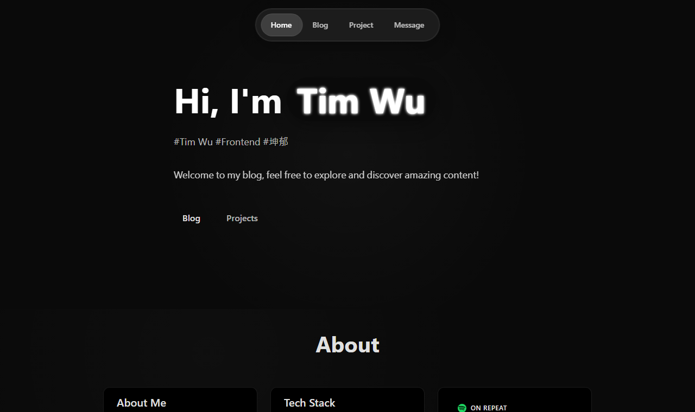

<div align="center">

# Tim Wu

個人網站 · 作品集 · 留言板

[**kenyykdblog.vercel.app**](https://kenyykdblog.vercel.app/)




</div>

## 技術棧

| 分類 | 技術                                                    |
| ---- | ------------------------------------------------------- |
| 前端 | Vue 3（Composition API + `<script setup>`）、TypeScript |
| 建置 | Vite                                                    |
| 路由 | Vue Router（HTML5 History 模式）                        |
| 狀態 | Pinia + Composables                                     |
| 後端 | Firebase Authentication、Cloud Firestore                |
| 部署 | Vercel                                                  |
| 樣式 | 原生 CSS，無 UI 框架                                    |

## 技術重點

### 前後端分離，無自建伺服器

整個網站是純前端 SPA，資料與登入都交給 Firebase。前端直接透過 Firebase SDK 存取 Firestore，權限由 Firestore Security Rules 在雲端把關，因此不需要另外架設 API 伺服器。

### 第三方登入

使用 Firebase Authentication 的 `signInWithPopup` 支援 Google 與 GitHub OAuth。登入狀態由 `onAuthStateChanged` 監聽，在 App 啟動時註冊一次，並存在模組層級的 `ref` 中，讓所有元件共用同一份使用者狀態。

### 即時留言

留言板以 Firestore 的 `onSnapshot` 訂閱留言集合，任何人新增或刪除留言，所有開著頁面的使用者都會即時看到更新。新增留言時使用 `serverTimestamp()`，以伺服器時間排序，避免使用者電腦時間不準造成順序錯亂。

### 狀態管理：Composables + Pinia

- `useAuth`、`useMessages` 這兩個 composable 封裝 Firebase 操作，狀態放在模組層級，多個元件呼叫時拿到的是同一份資料
- Pinia `auth` store 在 composable 之上提供整理過的使用者資料與管理員判斷

### SPA 路由與部署

Vue Router 使用 History 模式，網址沒有 `#`。由於直接開啟 `/blog` 這類路徑時，Vercel 找不到對應的檔案會回傳 404，因此用 `vercel.json` 把所有路徑導回 `index.html`，交給前端路由處理。push 到 `main` 後 Vercel 會自動建置並部署。

## 專案結構

```
src/
├── components/    共用元件（導覽列、登入視窗、留言表單、文字動畫）
├── composables/   useAuth、useMessages
├── config/        Firebase 初始化
├── router/        路由設定
├── stores/        Pinia store
└── views/         頁面
```

## 本機開發

```bash
npm install
npm run dev
```
